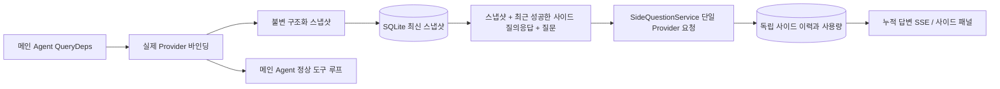

# ARTEX `/btw`

일반 채팅, 작업 MainAgent, 현재 작업 자신의 Worker 가 독립적인 사이드 질문을 지원한다. 메인 입력창에 `/btw 질문` 을 입력하면 제출되고, 빈 `/btw` 나 “사이드 질문” 버튼은 이력을 연다. 데스크톱은 너비를 조정할 수 있는 사이드바를, 모바일은 Drawer 를 쓴다.

사이드 답변은 제출 시점의 Agent 컨텍스트 스냅샷을 바탕으로 생성되며, 스트리밍 표시, 추가 질문, 중지, 비우기를 지원한다. 패널을 닫거나 페이지를 새로 고치거나 SSE 가 끊겨도 모델 요청이 취소되지 않는다. 중지는 현재 사이드에만 영향을 준다. 비우기는 사이드를 취소하고 사이드 이력을 삭제하되 메인 컨텍스트 스냅샷은 유지한다.

## 구현 경계

Go, norma v0.3.7, Next.js, 기존 Markdown / ResizablePanel / Drawer / AlertDialog 컴포넌트를 그대로 쓴다. norma 소스를 수정하거나 사이드를 위해 의존성을 추가하지 않았다. Planner, 다른 작업에서 상속받은 Worker, 도구형 하위 작업 승격은 이번 범위에 포함되지 않는다.

- `capture.go` 는 `Options.Deps.CallModel / CallModelSync` 로 표시된 메인 루프 요청만 다룬다. Provider 데코레이터는 구체 모델 내부, 라우팅 풀 바깥에서 선택된 뒤에 위치하므로 실제로 선택된 모델을 기록한다. 압축과 요약 요청은 스냅샷을 덮어쓰지 않는다.
- 요청 시작, 완전한 모델 응답, 실행 최종 상태에서 스냅샷을 발행한다. 생성 중인 반쪽 응답은 발행하지 않는다. 도구 호출은 norma 의 `MessagesForAPI` 로 짝을 유지하며, 도구 결과는 다음 메인 모델 요청이나 실행 최종 상태에서 스냅샷에 들어간다. 스트리밍 중단은 마지막 유효 경계를 유지한다.
- 스냅샷은 JSON 깊은 복사로 구조화 메시지, 시스템 프롬프트, 도구 정의, 생성 파라미터를 보존한다. 모델 추론은 스냅샷 잠금이나 데이터베이스 트랜잭션을 쥐지 않는다.
- `SideQuestionService` 는 구체 Provider 를 호출한다. 필요하면 먼저 사이드 요약을 생성하고, 최종 답변은 처음 컨텍스트 초과이고 아직 텍스트/도구 호출을 출력하지 않았을 때만 줄인 뒤 한 번 재시도한다. agent session 을 만들지 않고, 도구 실행기, 메인 transcript, 활동 스트림, 작업 그래프에 접속하지 않으며, 작업 모델 전환 체인을 거치지도 않는다. 답변이 도구 정의를 유지하는 것은 기존 구조화 도구 컨텍스트와 호환하기 위함이다. 요약 요청은 도구를 제공하지 않는다. 새로 반환된 도구 호출에는 실행 경로가 없다.
- 부모 대화마다 실행 요청 하나, 서비스 프로세스 하나당 최대 네 개, 단일 시간 초과 120 초. 사이드는 서비스 생명주기 아래의 독립 취소 컨텍스트를 쓴다.
- 사이드 요청은 모델 설정 참조와 비민감 신원 요약을 유지한다. 요청할 때 기존 설정에서 자격 증명을 얻는다. 설정이 삭제되거나 모델, 프로토콜, 주소 등 신원 필드가 바뀌면 먼저 메인 Agent 를 실행해 스냅샷을 갱신하도록 요구한다. 테스트는 제품 기본 모델을 바꾸지 않는다.

## 영속화와 복구

`db/schema.sql` 이 `side_question_sessions` 와 `side_question_requests` 를 자동 생성한다. 전자는 부모 리소스, 최신 스냅샷, 실행 번호, 버전, 정리 버전을 저장하고, 후자는 질문, 누적 답변, 상태, 모델, 스냅샷 시각, 사용량, 이벤트 순번, 페이지 순번을 저장한다.

부모 대화 키는 conversation ID, 또는 task ID + exploration ID + intent ID 를 쓴다. Worker 는 재사용 가능한 실행 슬롯 이름을 쓰지 않는다.

스냅샷은 부모 대화 단위로 병합해 쓰며 250 ms 마다 한 번 플러시한다. 데이터베이스는 `(run_id, version)` 을 비교해 오래된 버전이 덮어쓰는 것을 막는다. 사이드 제출 전에 선택한 스냅샷을 다시 저장한다. 성공적으로 저장하면 메모리의 큰 스냅샷을 해제하고, 실패하면 쓸 버전을 유지한다. 답변 누적 내용은 스트리밍 이벤트가 올 때 최대 250 ms 마다 한 번 쓰며, 최종 상태는 즉시 저장하고 데이터베이스 오류 시 제한적으로 재시도한다.

서비스가 시작하면 남아 있는 `running` 요청을 `interrupted` 로 표시하고, 이미 저장된 부분 답변과 사용량을 유지하며, 요청을 자동으로 재생하지 않는다. 가장 최근에 성공적으로 저장한 컨텍스트는 다음 질문에 바로 쓸 수 있다. 이전 대화에 스냅샷이 없으면 먼저 메인 Agent 를 실행하도록 요구하며, UI 활동 기록으로 컨텍스트를 재구성하지 않는다.

비우기 작업은 정리 버전을 올리고 요청을 삭제한다. 조건부 갱신이 늦게 온 콜백의 재기록을 막는다. 부모 리소스의 물리적 삭제는 외래 키 연쇄에 의존하며, Worker 논리 삭제는 같은 트랜잭션에서 사이드 데이터를 삭제하고 이후 늦게 온 스냅샷을 거부한다. 작업 보관은 먼저 새 요청을 막고, 메인 흐름이 멈추기를 기다리며, 사이드를 취소하고 저장을 기다린다. 보관 형식은 v3 이며, 사이드 테이블이 없는 v1/v2 도 함께 호환한다.

이력은 완전히 저장하며, 순번 커서로 페이지당 최대 20 건을 반환한다. 모델 요청은 최근 20 그룹의 성공한 질의응답 원문을 최대한 재생하면서 token 예산으로 재생량을 제한한다. 더 오래된 질의응답은 독립된 롤링 요약으로 관리한다. 메인 컨텍스트가 예산을 넘으면 사이드 복사본의 오래된 부분만 요약하고 최근의 구조화 도구 호출과 결과를 유지한다. 요약, 준비 진행 상황, 사용량은 모두 사이드의 동시 실행, 취소, 120 초 시간 초과 제한에 포함된다. 자세한 내용은 [컨텍스트 예산과 오픈 소스 참고](CONTEXT_BUDGET.md) 참고.

## HTTP 계약

아래 경로를 `{parent}` 로 두며, 기존 인증과 리소스 검증을 그대로 따른다:

- `/api/conversations/{id}`
- `/api/tasks/{id}/chat`
- `/api/tasks/{id}/intents/{iid}`

| 요청 | 반환과 동작 |
| --- | --- |
| `GET {parent}/side-questions?before={ordinal}` | `items` 는 최신순 정렬, 독립 `current` 실행 상태, `snapshot` 메타 정보, `next_cursor`. 커서가 0 이면 최신 페이지 / 다음 페이지 없음 |
| `POST {parent}/side-questions` | JSON `{ "question": "…", "client_request_id": "UUID" }`. 새 요청은 202 와 요청 객체를 반환하고, 같은 ID 와 질문은 기존 객체를 200 으로 반환 |
| `DELETE {parent}/side-questions` | 현재 부모 대화의 사이드 질의응답을 취소하고 비움 |
| `GET /api/side-questions/{requestID}/events` | `snapshot` SSE 이벤트, `id` 는 증가하는 순번, `data` 는 완전한 누적 요청 객체. 비울 때 `cleared` 를 보냄 |
| `POST /api/side-questions/{requestID}/cancel` | 명시적 취소. 최종 상태는 이력이나 SSE 에서 읽을 수 있음 |

질문 상한은 4000자. 스냅샷 없음, 모델 설정 변경, 같은 부모 대화 사용 중, 멱등 ID 충돌이면 409 를 반환하고, 전역 동시 실행 상한이면 429 를 반환한다. SSE 연결마다 먼저 누적 상태를 보내며, 클라이언트가 이전에 받은 텍스트 조각에 의존하지 않는다. 프론트엔드는 요청 ID + 순번으로 병합하고, 부모 대화를 바꾸거나 비울 때 오래된 콜백을 버린다.
